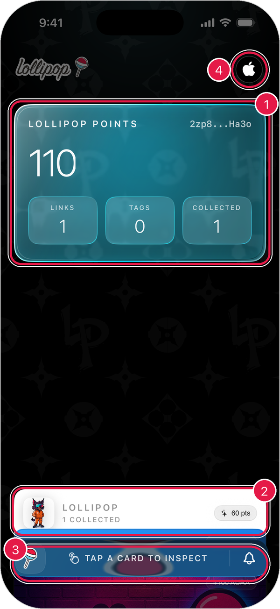

# Lollipop for iPhone

Lollipop turns real things into something you can tap. Tap a Lollipop product with your iPhone to claim it, earn points, and build your collection.

<figure><figcaption></figcaption></figure>

## What you can do

* **Collect**: tap Lollipop products to add them to your collection.
* **Earn points**: get Lollipop points when you claim eligible items.
* **Shop**: buy merch, drops, cards, and tags.
* **Make**: turn your own merch and playlists into things fans can tap.
* **Discover**: find brands, creators, and mixtapes.
* **Share**: get your own Lollipop Link, like `lollipop.gg/yourname`.

## Start here

1. [Getting Started](getting-started.md)
2. [Get Around the App](navigate-the-app.md)
3. [Claim Products and Rewards](claim-products-rewards.md)

## All topics

* [Getting Started](getting-started.md)
* [Sign In](sign-in.md)
* [Get Around the App](navigate-the-app.md)
* [Your Collection](collection.md)
* [Points and Rewards](rewards-points.md)
* [Claim Products and Rewards](claim-products-rewards.md)
* [Mixtapes](mixtapes.md)
* [Notifications](notifications.md)
* [Shop](shop.md)
* [Studio](studio.md)
* [Discover](discover.md)
* [Edit Your Profile](create-edit-profile.md)
* [Manage Your Lollipop Link](manage-lollipop-link.md)
* [Account Settings](account-settings.md)
* [Security and Privacy](security-privacy.md)
* [Troubleshooting](troubleshooting.md)

> This guide is for Lollipop for iPhone version 1.0.3.
