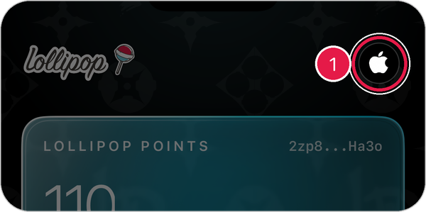
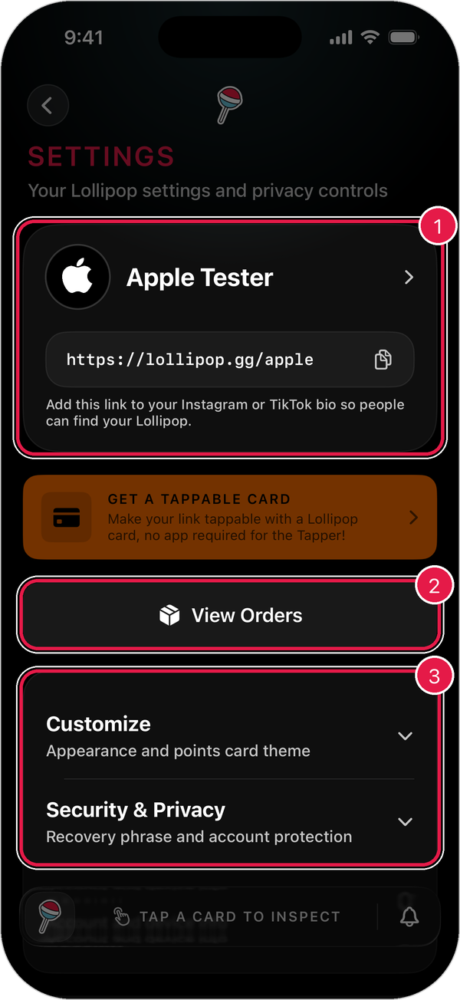
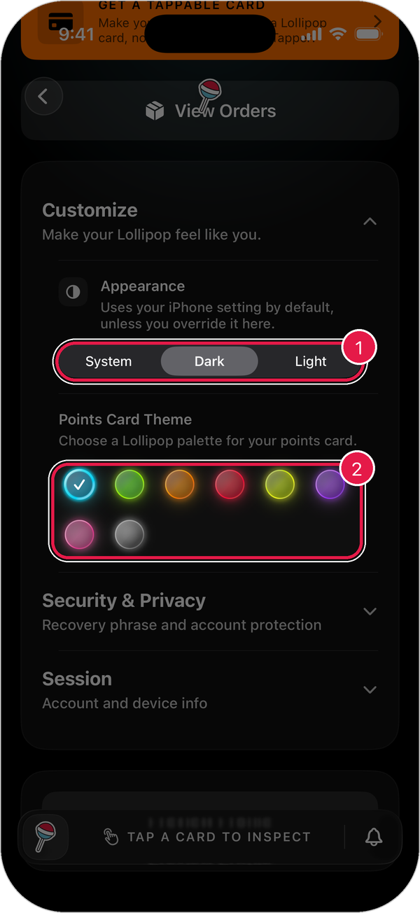
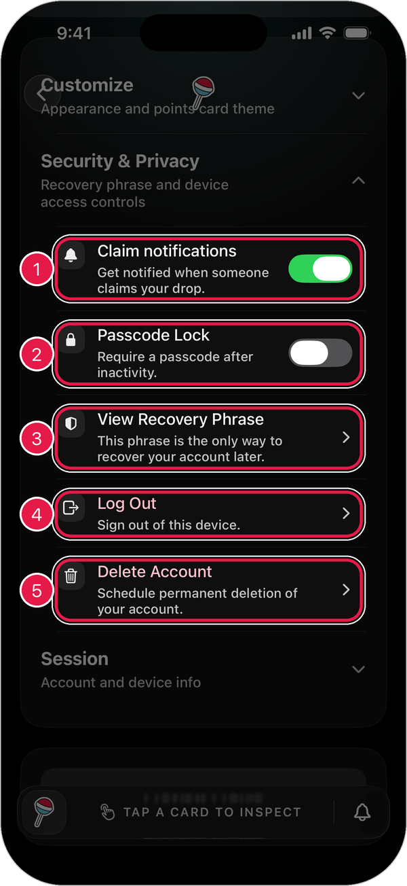
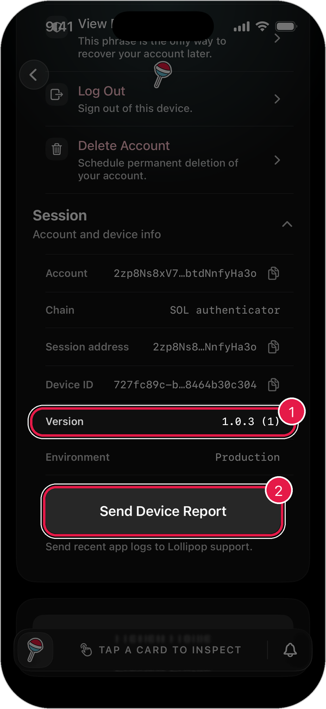

# Account Settings

Settings is where you change how the app looks, keep your account safe, and sign out.

## Open Settings

Tap the **profile button** in the top-right corner of the home screen.

<figure><figcaption></figcaption></figure>

<figure><figcaption></figcaption></figure>

1. **Your account**: your name and Lollipop Link. Tap it to edit your profile. [Learn more](create-edit-profile.md)
2. **View Orders**: see things you've bought in the Shop.
3. **Settings sections**: tap a section to open it.

To go back, tap the **back arrow** in the top-left corner.

## Customize

Change how Lollipop looks.

1. Tap **Customize**.
2. Under **Appearance**, pick **System**, **Dark**, or **Light**.
3. Under **Points Card Theme**, tap a color for your points card.

<figure><figcaption></figcaption></figure>

1. **Appearance**: **System** matches your iPhone's setting.
2. **Points Card Theme**: the check mark shows your current color.

## Security & Privacy

Keep your account safe.

<figure><figcaption></figcaption></figure>

1. **Claim notifications**: get a notification when someone claims your drop.
2. **Passcode Lock**: ask for a passcode after you've been away from the app for a while.
3. **View Recovery Phrase**: see the secret words that restore your account. [Learn more](security-privacy.md)
4. **Log Out**: sign out of Lollipop on this iPhone.
5. **Delete Account**: schedule your account to be permanently deleted.

> Warning: Before you **Log Out** or **Delete Account**, make sure you've saved your recovery phrase. It's the only way to get your account back.

## Session

Details about your account and this iPhone. These are useful if you contact support.

<figure><figcaption></figcaption></figure>

1. **Version**: the version of the app you're using.
2. **Send Device Report**: sends recent app logs to Lollipop support. Use this if support asks for it.
