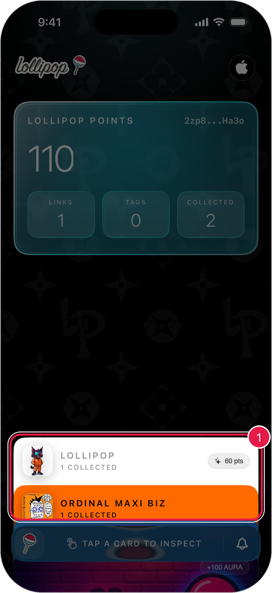
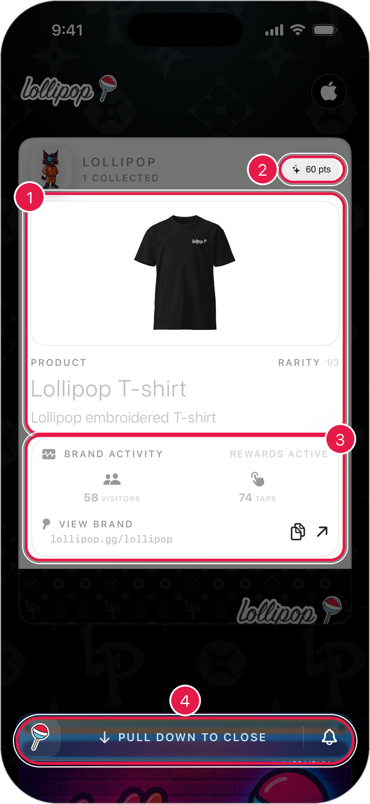

# Your Collection

Your collection is the home screen of the app. Everything you claim shows up here as a card.

## See your cards

1. Open the app. You start on **Collection**.
2. Your cards are stacked under the points card.

<figure><figcaption></figcaption></figure>

Each card is one brand. It shows how many items you've collected from them.

> Tip: To get back here from anywhere, tap the **lollipop button** and then **collection**.

## Look at a card

1. Tap a card in the stack.
2. The card opens so you can see the details.

<figure><figcaption></figcaption></figure>

1. **Product**: the photo, name, description, and **Rarity** (for example, **1/3** means it's one of three).
2. **Points**: how many points you've earned from this brand.
3. **Brand Activity**: how many people visited and tapped this brand. Tap **View Brand** to open their page, or the copy button to copy their link.
4. **Pull down to close**: drag the card down to put it back in the stack.

> Tip: If a brand has more than one item, swipe left or right on the card to see the rest.

## Starter cards

New accounts also see a few helper cards in the stack, like **Complete Your Profile** and **Lollipop NFC Cards**. Tap one to open it.

To remove a helper card, open it and press and hold **Hold to Dismiss**.

## Refresh your collection

Pull down on the **points card** at the top of the screen. The bar at the bottom says **REFRESHING YOUR STASH** while it updates.

## If a card is missing

1. Make sure your claim finished. You'll see a success screen when it does.
2. Pull down on the points card to refresh.
3. Make sure you're signed in to the right account. Check the name in **Settings**.
