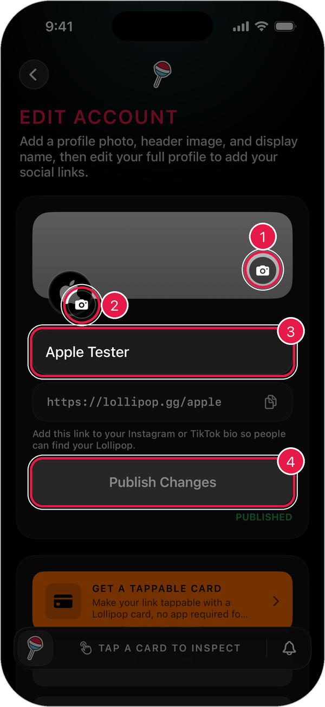
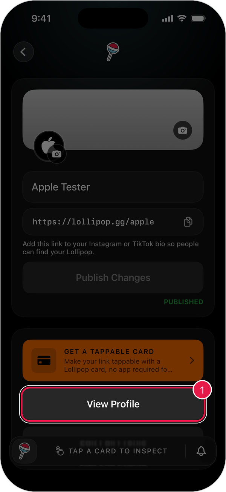
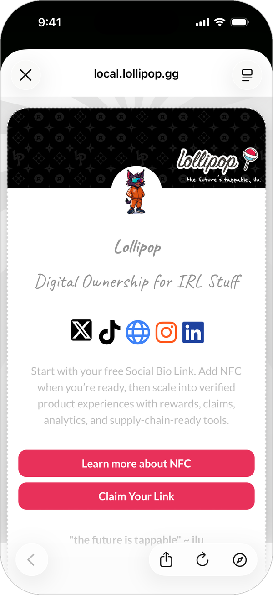
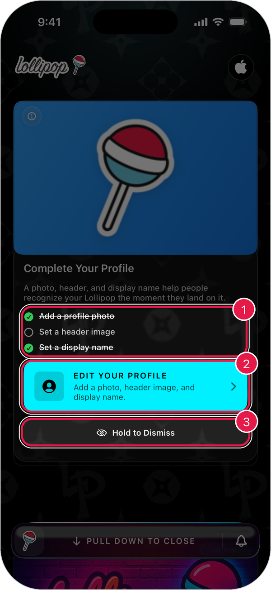

# Edit Your Profile

Your profile is what people see when they open your Lollipop Link: your photo, header image, and name.

## Open your profile

1. Tap the **profile button** in the top-right corner of the home screen.
2. Tap your name at the top of **Settings**.

The **Edit Account** screen opens.

<figure><figcaption></figcaption></figure>

1. **Header image**: tap the camera to pick a new header.
2. **Profile photo**: tap the camera to pick a new photo.
3. **Display name**: tap to change your name.
4. **Publish Changes**: tap to make your changes live.

## Change your profile

1. Make your changes.
2. Tap **Publish Changes**.
3. When the app asks, check the request and tap **Approve Update**.
4. Wait for the label under the button to say **PUBLISHED**.

> Tip: Your changes aren't live until you publish them. If you leave without publishing, the app asks if you want to keep or discard them.

## See what everyone else sees

1. Scroll down on **Edit Account**.
2. Tap **View Profile**.

<figure><figcaption></figcaption></figure>

Your public page opens.

<figure><figcaption>
Example: the Lollipop profile.
</figcaption></figure>

Tap **X** to close it.

## Add social links and more

Tap **Edit Full Profile** under **View Profile** to open the full editor. You can add buttons for your social accounts, shop, music, and more. [Learn more](manage-lollipop-link.md)

## Finish your profile

New accounts get a **Complete Your Profile** card in their collection. It shows what's left to do.

<figure><figcaption></figcaption></figure>

1. **Checklist**: crossed-out items are done.
2. **Edit Your Profile**: opens **Edit Account**.
3. **Hold to Dismiss**: press and hold to remove the card.
