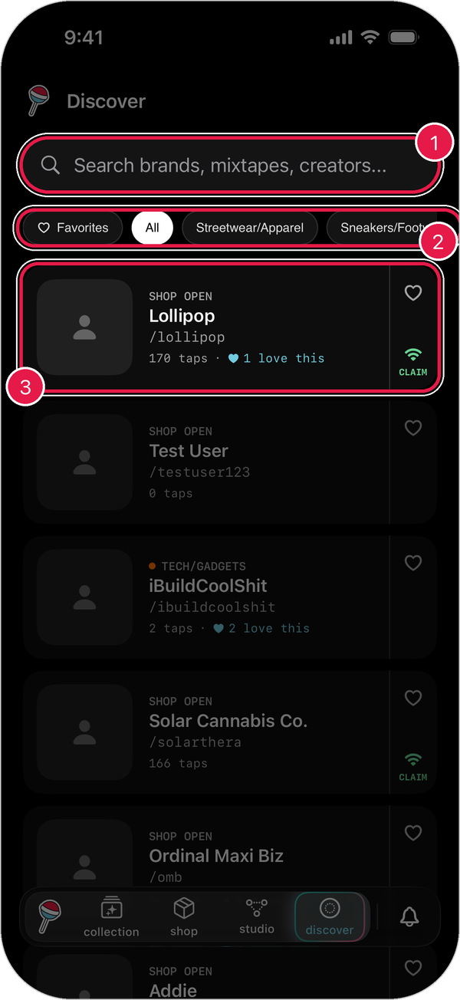
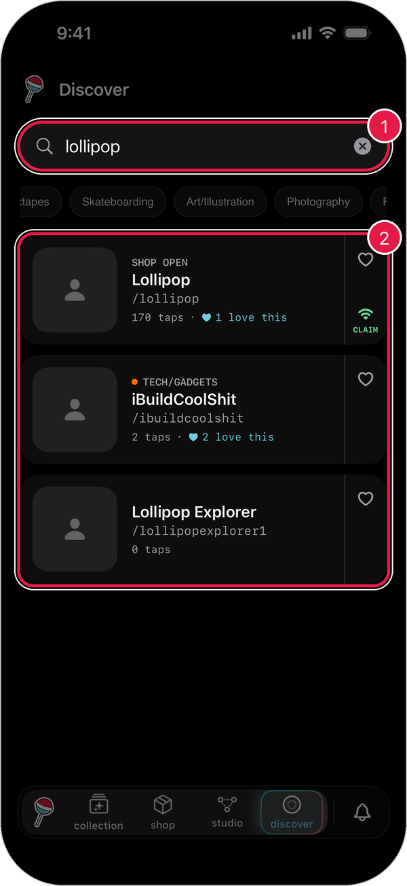

# Discover

Discover helps you find brands, creators, and mixtapes on Lollipop.

## Open Discover

1. Tap the **lollipop button** at the bottom of the screen.
2. Tap **discover**.

<figure><figcaption></figcaption></figure>

1. **Search**: look up a brand, mixtape, or creator by name.
2. **Categories**: tap one, like **Streetwear/Apparel** or **Music/Mixtapes**. Swipe left for more.
3. **Results**: tap one to open their page.

## What the labels mean

* **Shop Open**: they have things for sale.
* **Taps**: how many times people have tapped their products.
* **Claim**: they have something you can claim right now.

## Search

1. Tap the search bar.
2. Type a name, like **lollipop**.
3. Tap **Search** on your keyboard.

<figure><figcaption></figcaption></figure>

To clear your search, tap the **x** in the search bar.

> Tip: If nothing comes up, try browsing a category instead.

## Save your favorites

1. Tap the **heart** on a result to save it.
2. Tap **Favorites** to see everything you've saved.

Tap the heart again to remove it.
