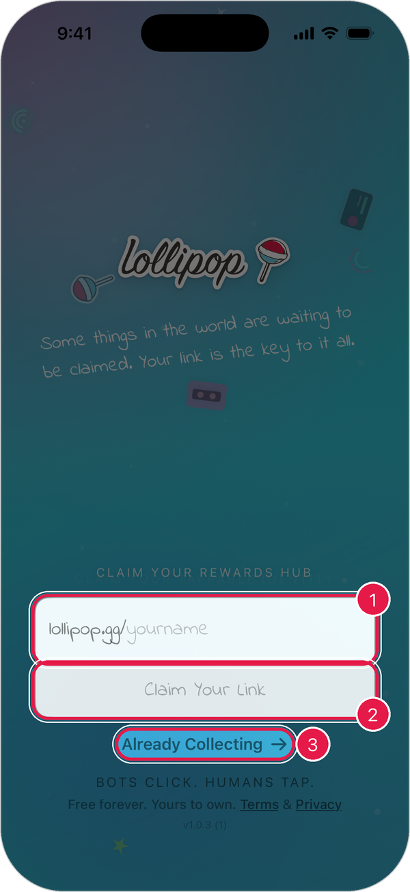
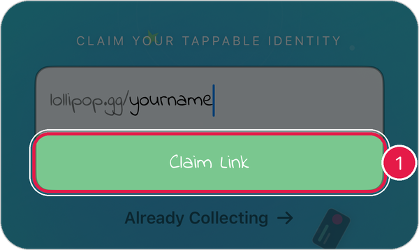
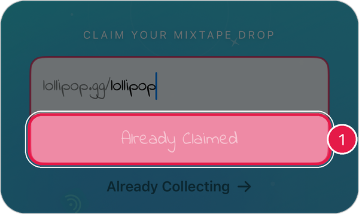

# Getting Started

Set up Lollipop on your iPhone in about a minute.

## What you need

* An iPhone
* The **Lollipop** app from the App Store
* An internet connection

## 1. Claim your link

When you open Lollipop for the first time, you'll pick your own link, like `lollipop.gg/yourname`.

<figure><figcaption></figcaption></figure>

1. Tap the box and type the name you want.
2. When the button turns green and says **Claim Link**, tap it.
3. Already have a Lollipop account? Tap **Already Collecting** instead. [See how to sign in](sign-in.md)

The button tells you if your name is free:

<figure><figcaption>
Green <strong>Claim Link</strong>: the name is free.
</figcaption></figure>

<figure><figcaption>
Red <strong>Already Claimed</strong>: someone has it. Try another name.
</figcaption></figure>

> Tip: Names can use letters, numbers, and dashes.

## 2. Create a passcode

After your account is created, the app asks you to create a **6-digit passcode**.

1. Type 6 digits.
2. Type them again to confirm.

The passcode keeps your account safe if you leave the app for a while. You can also unlock with **Face ID**.

> Tip: Not ready? Tap **Skip**. You can turn on a passcode later in **Settings** > **Security & Privacy**.

## 3. Save your recovery phrase

Your recovery phrase is the only way to get your account back if you lose your phone. Save it now.

1. Tap the **profile button** in the top-right corner of the home screen.
2. Open **Security & Privacy**.
3. Tap **View Recovery Phrase** and write the words down somewhere safe.

[Learn more about keeping your account safe](security-privacy.md)

## 4. Finish your profile

Your collection starts with a **Complete Your Profile** card. Tap it to add a photo, header image, and name.

<figure><figcaption></figcaption></figure>

[See how to edit your profile](create-edit-profile.md)

## Next steps

* [Get around the app](navigate-the-app.md)
* [Claim your first product](claim-products-rewards.md)
