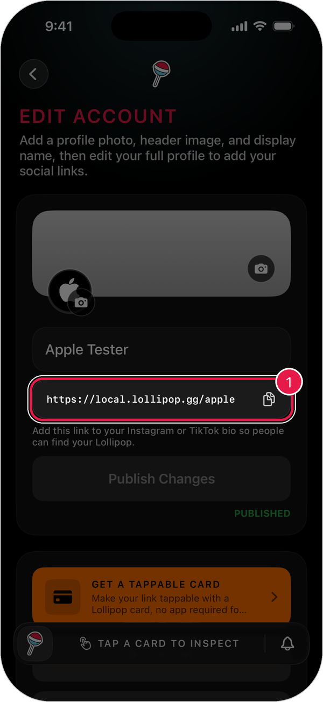
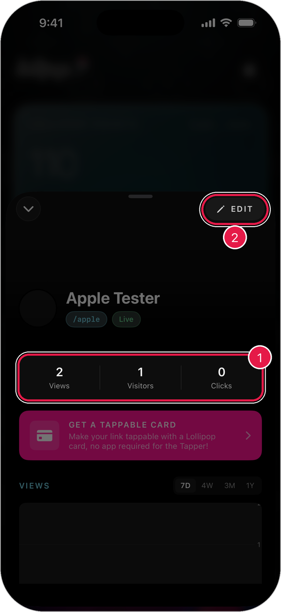
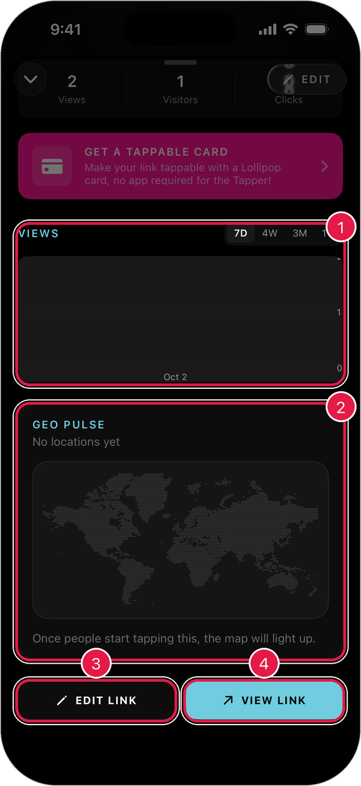
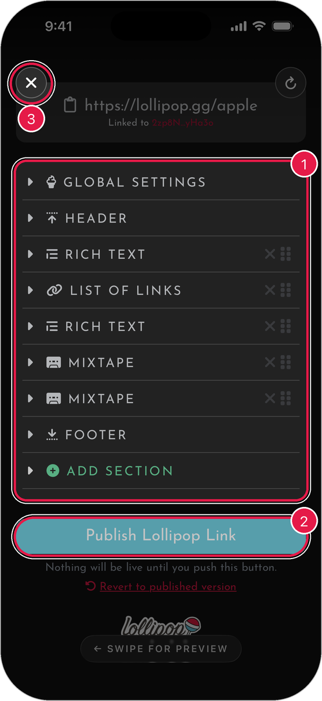

# Manage Your Lollipop Link

Your **Lollipop Link** is your own page, like `lollipop.gg/yourname`. Share it anywhere, and anyone can open it without the app.

## Copy your link

1. Tap the **profile button** in the top-right corner of the home screen.
2. Tap the **copy button** next to your link.

<figure><figcaption></figcaption></figure>

> Tip: Paste your link into your Instagram or TikTok bio so people can find your Lollipop.

## See how your link is doing

1. Tap the **points card** on the home screen.
2. Under **Links**, tap your link.

<figure><figcaption></figcaption></figure>

1. **Views, Visitors, and Clicks** for your link.
2. **Edit**: opens the link editor.

Scroll down to see more.

<figure><figcaption></figcaption></figure>

1. **Views**: how many people opened your link. Tap **7D**, **4W**, **3M**, or **1Y** to change the time range.
2. **Geo Pulse**: where people are tapping. The map lights up as taps come in.
3. **Edit Link**: change what's on your page.
4. **View Link**: see your page the way everyone else does.

## Edit your link

1. Tap **Edit Link**.
2. Tap a section to open it, like **Header** or **List of Links**.
3. Make your changes.
4. Tap **Publish Lollipop Link** to make them live.

<figure><figcaption></figcaption></figure>

1. **Sections**: everything on your page. Tap **Add Section** to add more.
2. **Publish Lollipop Link**: nothing goes live until you tap this.
3. **Close**: leave the editor. Your changes are saved as a draft for later.

> Tip: Swipe left to preview your page as you edit. Swipe right to go back to editing.

> Tip: Changed your mind? Tap **Revert to published version** to throw away your unpublished changes.

## Add another link

You can have more than one Lollipop Link, like one for each project.

1. Open **Studio**.
2. Under **Links**, tap **Add**.

Each link gets its own products, rewards, and stats.
