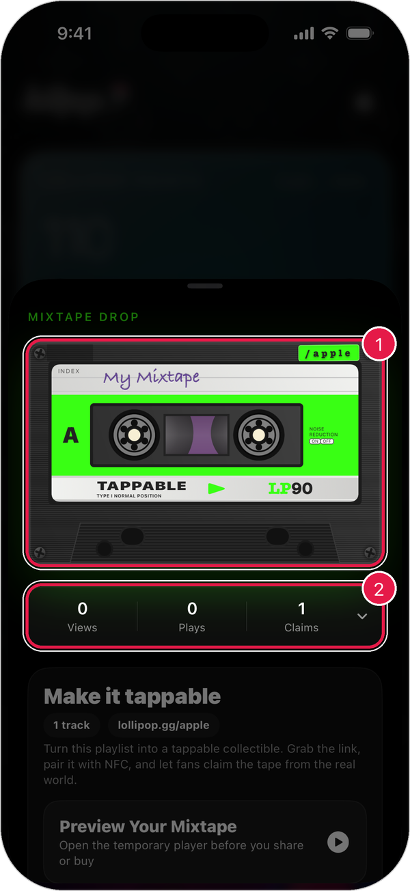
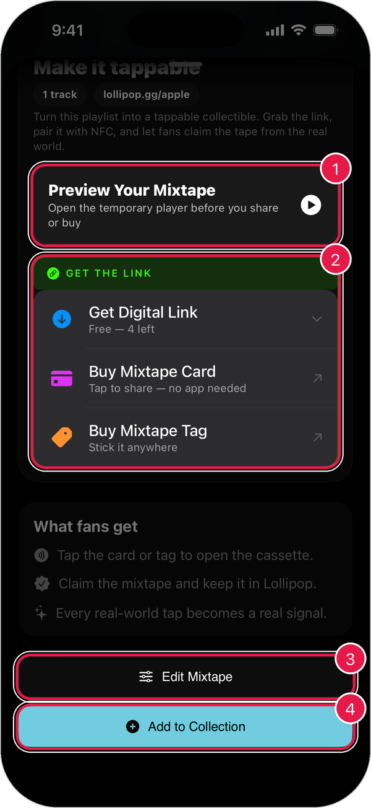

# Mixtapes

A **mixtape** is a playlist you can tap. Fans tap a card, tag, or piece of merch to open your mixtape and save it to their Lollipop.

## See your mixtape

1. Tap the **points card** on the home screen.
2. Under **Mixtapes**, tap your mixtape.

<figure><figcaption></figcaption></figure>

1. **Your mixtape**: how it looks to fans.
2. **Views, Plays, and Claims**: how fans are using it.

## Share it

Scroll down to see your options.

<figure><figcaption></figcaption></figure>

1. **Preview Your Mixtape**: hear it the way fans will.
2. **Get the Link**:
   * **Get Digital Link**: a link anyone can open.
   * **Buy Mixtape Card**: a card people tap with their phone. No app needed.
   * **Buy Mixtape Tag**: a sticker tag you can put anywhere.
3. **Edit Mixtape**: change the songs, name, or style.
4. **Add to Collection**: save it to your own collection.

## What fans get

* Tap the card or tag to open the mixtape.
* Claim the mixtape and keep it in their Lollipop.
* Every real-world tap shows up in your stats.

## Make a new mixtape

See [Studio](studio.md#make-a-mixtape).
