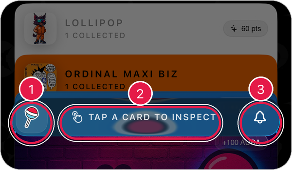
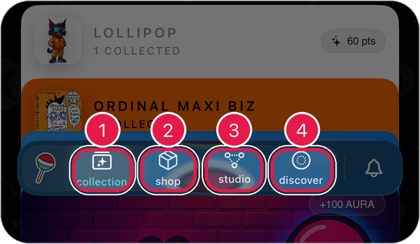
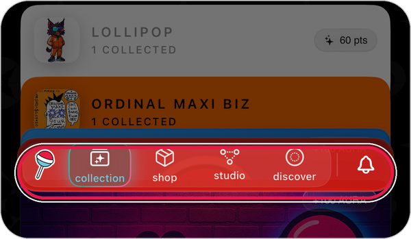

# Get Around the App

Lollipop has four main sections. You move between them with the **lollipop bar** at the bottom of the screen.

<figure><figcaption></figcaption></figure>

1. **Points card**: your Lollipop points and totals.
2. **Your cards**: everything you've collected.
3. **Lollipop bar**: tips, navigation, and notifications.
4. **Profile button**: opens **Settings**.

## The lollipop bar

When the bar is closed, it shows a short tip for the screen you're on.

<figure><figcaption></figcaption></figure>

1. **Lollipop button**: tap to open the menu.
2. **Tip**: what you can do on this screen, like **TAP A CARD TO INSPECT**.
3. **Bell**: opens your notifications.

## Switch sections

1. Tap the **lollipop button** on the left of the bar.
2. The bar opens and shows four sections.
3. Tap the one you want.

<figure><figcaption></figcaption></figure>

1. **Collection**: your points and the things you've collected. [Learn more](collection.md)
2. **Shop**: buy merch, cards, and tags. [Learn more](shop.md)
3. **Studio**: make your own things tappable. [Learn more](studio.md)
4. **Discover**: find brands, creators, and mixtapes. [Learn more](discover.md)

The section you're in is outlined in the bar.

> Tip: Swipe left or right with **two fingers** to slide between sections.

## When the bar turns red

A red bar means the app can't reach the internet.

<figure><figcaption></figcaption></figure>

1. Check your Wi-Fi or cellular connection.
2. Pull down on the points card to refresh.

The bar turns back to normal once you're connected.
