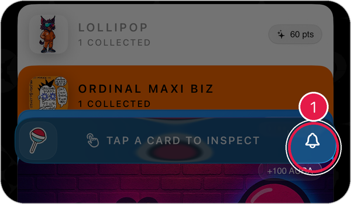
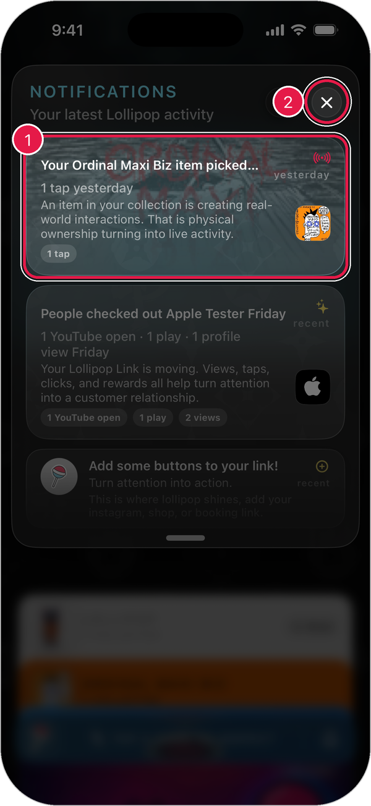

# Notifications

Notifications show what's happening with your Lollipop, like when someone taps your item or visits your link.

## Open your notifications

Tap the **bell** on the right side of the lollipop bar.

<figure><figcaption></figcaption></figure>

The notifications panel slides down from the top.

<figure><figcaption></figcaption></figure>

1. **A notification**: tap it to see more.
2. **Close**: tap **X** to put the panel away.

> Tip: Pull down on the list to check for new notifications.

## What you'll see

* **Activity on your items**: when someone taps something in your collection.
* **Activity on your link**: views, plays, and taps on your Lollipop Link.
* **Tips**: ideas to get more out of Lollipop, like adding buttons to your link.

## Get notified when someone claims your drop

1. Tap the **profile button** in the top-right corner of the home screen.
2. Open **Security & Privacy**.
3. Turn on **Claim notifications**.

See [Account Settings](account-settings.md) for more.
