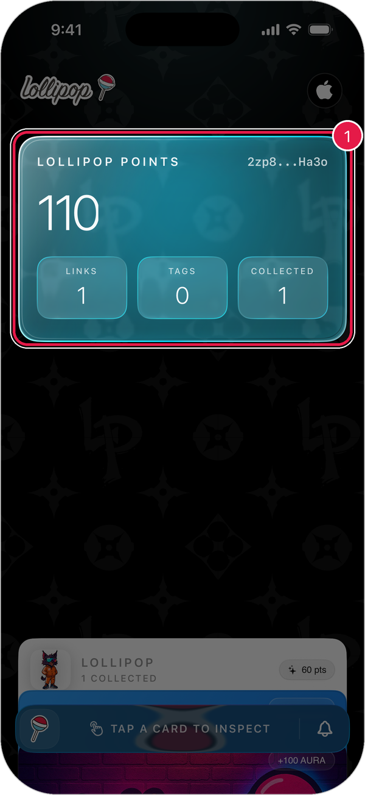
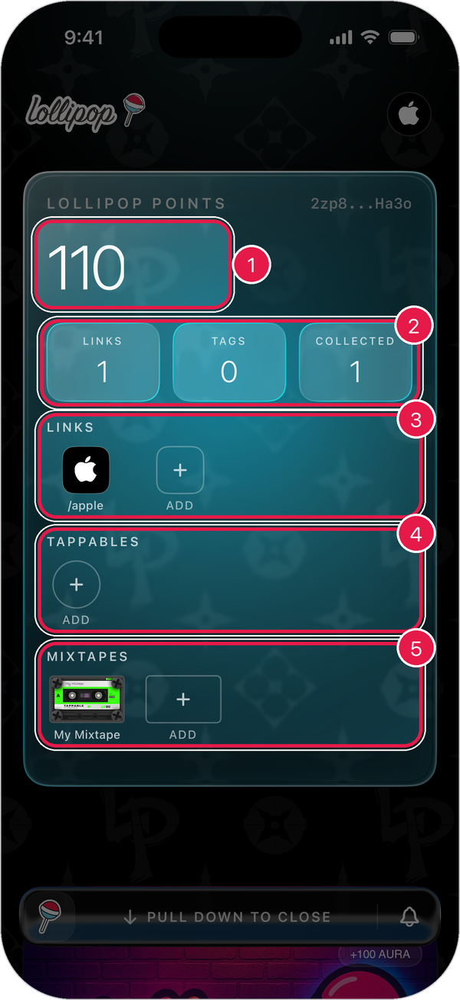

# Points and Rewards

You earn Lollipop points when you claim eligible products. Your points live on the **points card** at the top of your collection.

## See your points

<figure><figcaption></figcaption></figure>

The big number is your point balance. Under it you'll see:

* **Links**: how many Lollipop Links you have.
* **Tags**: how many tappable tags you own.
* **Collected**: how many items you've claimed.

## Open the points card

1. Tap the points card.
2. It opens to show everything you own.

<figure><figcaption></figcaption></figure>

1. **Your points**.
2. **Totals**: Links, Tags, and Collected.
3. **Links**: tap a link to edit it, or **Add** to make a new one.
4. **Tappables**: your tags and stickers.
5. **Mixtapes**: mixtapes you've made.

To close it, drag the card down.

## How to earn points

1. Tap an eligible Lollipop product with your iPhone.
2. Claim it. [See how](claim-products-rewards.md)
3. The points are added to your balance.

Not every product gives points. If one does, you'll see the amount before you claim it.

> Tip: Each brand card in your collection shows the points you've earned from that brand, like **60 pts**.

## If your points look wrong

1. Pull down on the points card to refresh.
2. Make sure the claim finished. You'll see a success screen when it does.
3. Remember that not every product gives points.
