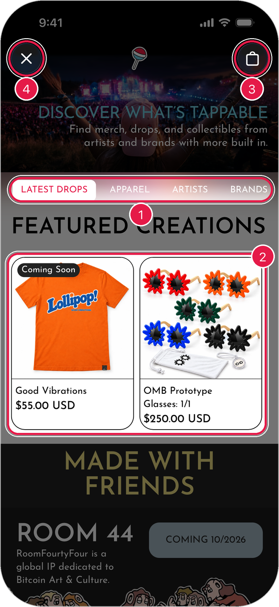
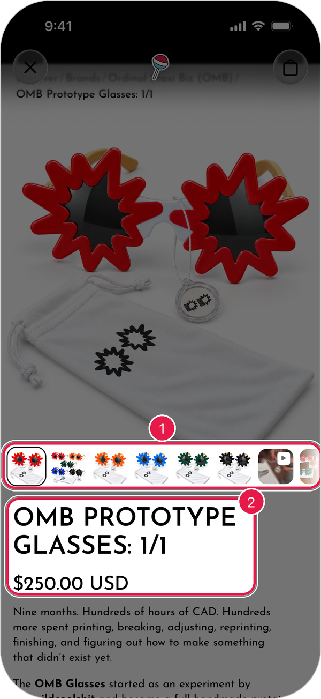
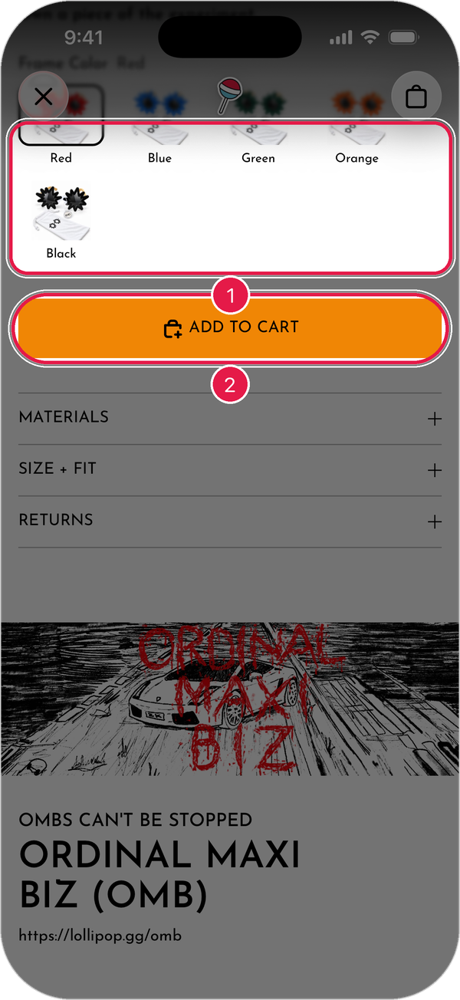
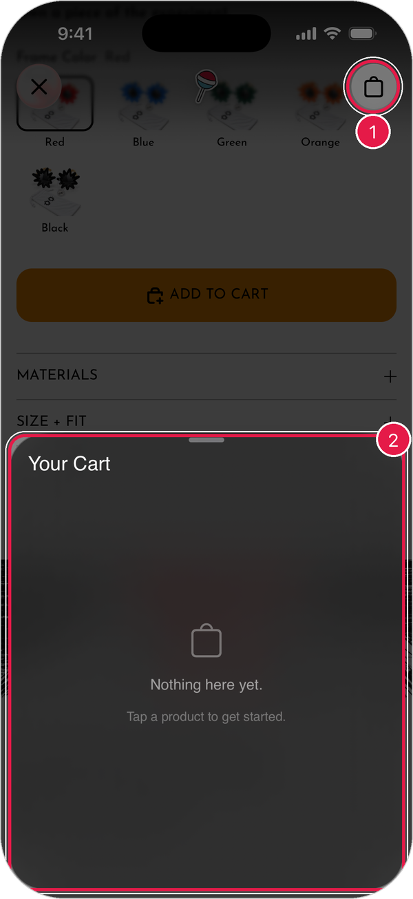
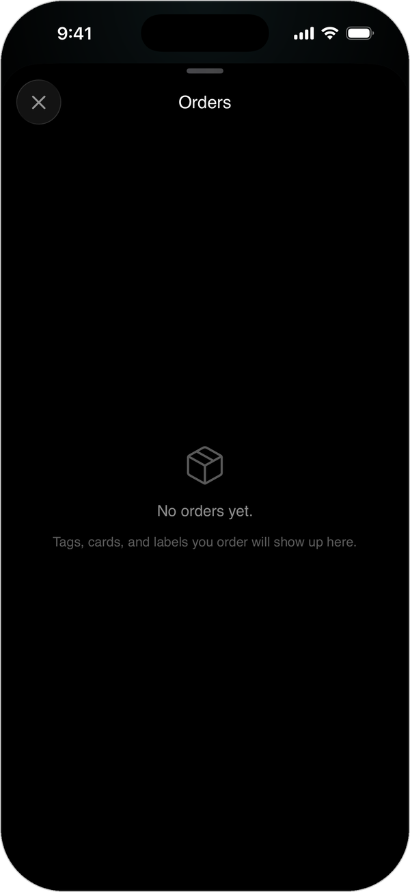

# Shop

Shop is where you buy merch and drops from artists and brands. Many of them come with a Lollipop tag built in, so you can tap them to claim a matching collectible.

## Open the Shop

1. Tap the **lollipop button** at the bottom of the screen.
2. Tap **shop**.

<figure><figcaption></figcaption></figure>

1. **Categories**: switch between **Latest Drops**, **Apparel**, **Artists**, and **Brands**.
2. **Products**: tap one to see more.
3. **Cart**: see what you've added.
4. **Close**: go back to where you were.

> Tip: Items marked **Coming Soon** aren't for sale yet. Check back later.

## Look at a product

1. Tap a product.
2. Swipe through the photos at the top.
3. Scroll down to read about it.

<figure><figcaption></figcaption></figure>

1. **Photos**: tap one to see it larger.
2. **Name and price**.

## Add it to your cart

1. Pick an option, like a color or size.
2. Tap **Add to Cart**.

<figure><figcaption></figcaption></figure>

## Check out

1. Tap the **cart** in the top-right corner.
2. Review your items.
3. Tap **Checkout** and follow the steps to pay.

<figure><figcaption></figcaption></figure>

> Tip: If your cart is empty, you'll see **Nothing here yet**. Tap a product to get started.

## See your orders

1. Tap the **profile button** in the top-right corner of the home screen.
2. Tap **View Orders**.

<figure><figcaption></figcaption></figure>

Tags, cards, and labels you order show up here.

## If the Shop won't load

If you see **Couldn't load the shop right now**, check your internet connection and tap **Try Again**.
