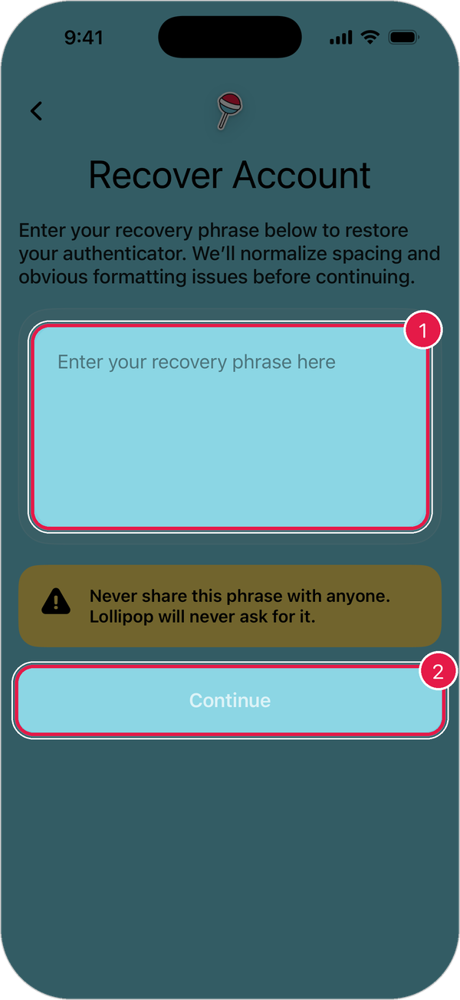

# Sign In

Lollipop doesn't use an email and password. Your account lives on your iPhone, and your **recovery phrase** is how you bring it to a new phone.

## Sign in on a new iPhone

You'll need your recovery phrase.

1. Open Lollipop.
2. On the welcome screen, tap **Already Collecting**.
3. Type or paste your recovery phrase into the box.
4. Tap **Continue**.

<figure><figcaption></figcaption></figure>

1. **Recovery phrase**: type the words in order, with a space between each one.
2. **Continue**: signs you in.

> Warning: Never share your recovery phrase with anyone. Lollipop will never ask for it.

## Unlock the app

If you turned on **Passcode Lock**, Lollipop asks for your passcode when you come back after a while.

* Enter your **6-digit passcode**, or
* Tap **Unlock with Face ID**.

You won't be asked every time you open the app, only after you've been away for a bit.

## Sign out

1. Tap the **profile button** in the top-right corner of the home screen.
2. Open **Security & Privacy**.
3. Tap **Log Out**.

> Warning: Save your recovery phrase before you sign out. Without it, you can't get back into your account.

## If you can't sign in

* **Check your recovery phrase.** Make sure every word is spelled right and in the right order.
* **Forgot your passcode?** Try **Unlock with Face ID**. If that doesn't work, contact Lollipop support.
* **Lost your recovery phrase?** If you're still signed in on another phone, open **Settings** > **Security & Privacy** > **View Recovery Phrase** there.
