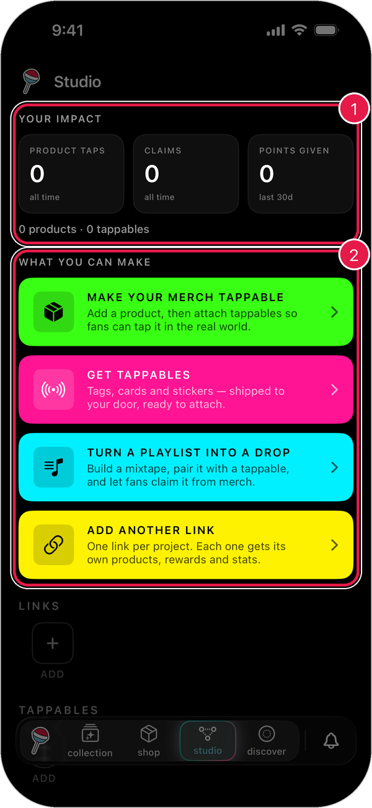
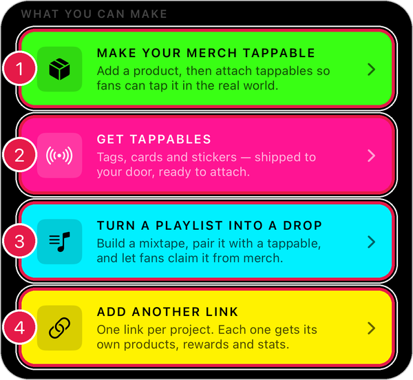
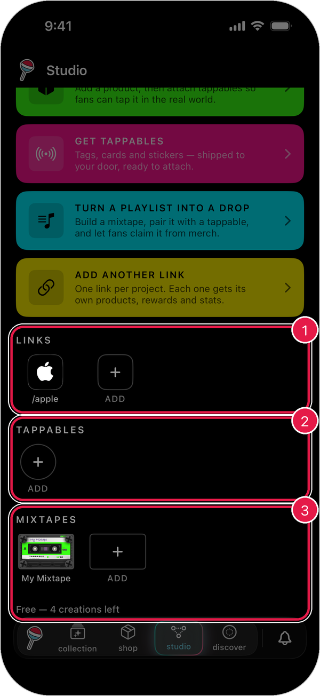
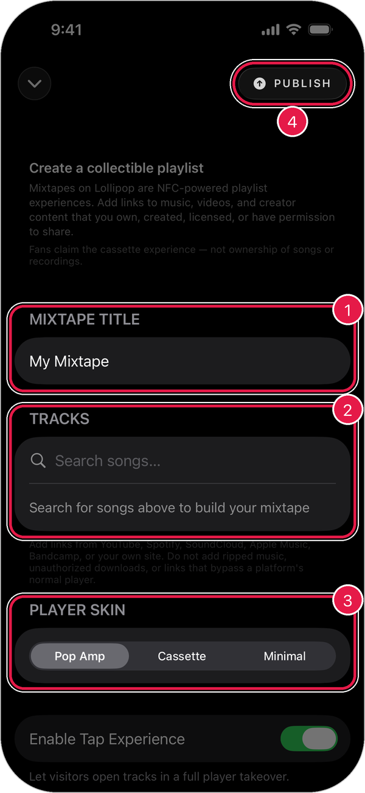

# Studio

Studio is where you make things people can tap in real life, like your merch, a mixtape, or a card that opens your Lollipop Link.

## Open Studio

1. Tap the **lollipop button** at the bottom of the screen.
2. Tap **studio**.

<figure><figcaption></figcaption></figure>

1. **Your Impact**: how many times people tapped your products, how many claims you've had, and the points you've given out.
2. **What You Can Make**: ideas to get started.

## What you can make

<figure><figcaption></figcaption></figure>

1. **Make Your Merch Tappable**: add a product, then attach tappables so fans can tap it.
2. **Get Tappables**: order tags, cards, and stickers, shipped to your door.
3. **Turn a Playlist into a Drop**: build a mixtape fans can claim from your merch. [Learn more](mixtapes.md)
4. **Add Another Link**: start a new Lollipop Link for a new project. Each link gets its own products, rewards, and stats.

## Your stuff

Scroll down to see everything you've made.

<figure><figcaption></figcaption></figure>

1. **Links**: your Lollipop Links. Tap one to edit it.
2. **Tappables**: tags, cards, and stickers you own.
3. **Mixtapes**: mixtapes you've made.

Tap **Add** in any row to make a new one.

> Tip: Free accounts get a few free creations. Studio shows how many you have left, like **Free — 4 creations left**.

## Make a mixtape

1. Tap **Turn a Playlist into a Drop**.
2. Give your mixtape a name.
3. Search for songs and add them.
4. Pick a player style.
5. Tap **Publish** when you're happy with it.

<figure><figcaption></figcaption></figure>

1. **Mixtape Title**: what fans will see.
2. **Tracks**: search for songs from YouTube, Spotify, SoundCloud, Apple Music, Bandcamp, or your own site.
3. **Player Skin**: choose **Pop Amp**, **Cassette**, or **Minimal**.
4. **Publish**: make it live.

> Important: Only add music and videos you own, made, licensed, or have permission to share.

To close the builder without publishing, tap the arrow in the top-left corner.
