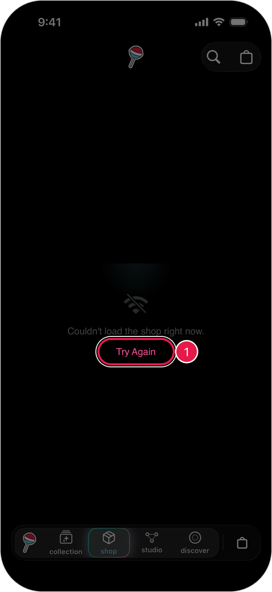

# Troubleshooting

Quick fixes for the most common problems.

## The bar at the bottom turned red

A red bar that says **NO INTERNET** means the app can't connect.

<figure><figcaption></figcaption></figure>

1. Check that Wi-Fi or cellular data is on.
2. Pull down on the points card to refresh.
3. If it stays red, close the app and open it again.

## A screen says "Couldn't load" or won't finish loading

<figure><figcaption></figcaption></figure>

1. Tap **Try Again** if you see it.
2. Check your internet connection.
3. Close the app and open it again.

## I tapped a product and nothing happened

1. Unlock your iPhone first.
2. Hold the top of your iPhone close to the Lollipop tag for a second or two.
3. Try again, moving your phone slowly over the tag.
4. Make sure the product has a Lollipop tag.

## My claim didn't work

1. If you see **This claim expired**, tap the item again to start a new claim.
2. If you see **Already Claimed**, someone has already added this item to their Lollipop.
3. Check your internet connection and try again.

See [Claim Products and Rewards](claim-products-rewards.md) for more.

## I don't see something I claimed

1. Make sure the claim finished. You'll see a success screen when it does.
2. Pull down on the points card to refresh.
3. Make sure you're on the right account. Check the name at the top of **Settings**.

## My points look wrong

1. Pull down on the points card to refresh.
2. Not every product gives points.

## My profile changes didn't show up

1. Make sure you tapped **Publish Changes** and approved the update.
2. Check that **Edit Account** says **PUBLISHED**.
3. Tap **View Profile** to see what's live.

## I'm signed in to the wrong account

1. Save the recovery phrase for this account first. [See how](security-privacy.md)
2. Open **Settings** > **Security & Privacy**.
3. Tap **Log Out**.
4. On the welcome screen, tap **Already Collecting** and enter the recovery phrase for the right account.

## Still stuck?

Send a device report so our team can take a look:

1. Open **Settings** and tap **Session**.
2. Tap **Send Device Report**.

<figure><figcaption></figcaption></figure>
